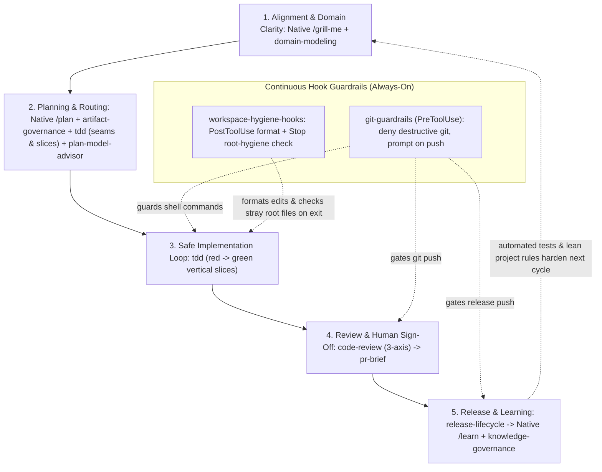

# Agentic Pair Programming Protocol

A practical, end-to-end guide to pairing with **Google Antigravity** using the **20 à la carte plugins** in [`antigravity-customizations`](../README.md) (**8 core lifecycle skills**, **2 always-on guardrail hook plugins**, and **10 situational skills**) alongside Antigravity's native slash commands (`/grill-me`, `/plan`, `/teamwork`, `/compact`, `/learn`).

Every plugin is **standalone and optional**—if you omit a plugin at any stage, the remaining stages degrade cleanly without failing. Think of this document as the **reference choreography** showing how the pieces reinforce one another across a full feature lifecycle.

> **Quick Orientation: Commands, Plugins & Where Files Live**
> * **Native Antigravity Slash Commands** (type directly in chat): `/grill-me` (requirements interview), `/plan` (drafts/updates `implementation_plan.md`), `/teamwork` (runs multiple cooperating agents in parallel), `/compact` (summarizes the current chat in-place to free context), and `/learn` (proposes persisting lessons from the session).
> * **Plugin Triggering:** **Skills** activate automatically when your prompt matches their description, explicitly when you name them in chat (e.g., *"Run `code-review` since `main`"*), or via their **`suggestedPrompts`** chips in Antigravity's UI. **Hook plugins** (`git-guardrails`, `workspace-hygiene-hooks`) fire automatically around the AI's tool actions with zero prompting (here, `PreToolUse` runs before a shell command, `PostToolUse` runs after a file edit, and `Stop` runs right before the AI finishes its reply).
> * **Session Artifacts vs. Repo Files:** `implementation_plan.md`, `walkthrough.md`, `handoff_<slug>.md`, and Antigravity's per-session scratch directory are **Antigravity Session Artifacts** (managed automatically per conversation outside your git repo and viewable in Antigravity's Artifacts pane). Within a single multi-milestone chat, `implementation_plan.md` and `walkthrough.md` grow as append-only ledgers; when starting a fresh chat via [`session-handoff`](../plugins/session-handoff/README.md), the new chat reads the old plan via its absolute path while keeping its own fresh ledger (or teams commit long-lived plans under `docs/`). Files like `AGENTS.md`, `GLOSSARY.md`, `CODING_STANDARDS.md`, `docs/adr/`, `CHANGELOG.md`, and `ROADMAP.md` live **inside your git repository**.
> * First time installing plugins? Start with [Quick Start in the README](../README.md#quick-start-adopt-à-la-carte). You do **not** need to pre-create `AGENTS.md`, `GLOSSARY.md`, `CODING_STANDARDS.md`, or a `Justfile`—every plugin works out of the box (and optional `repo-bootstrap` can scaffold them later). For upstream attribution (`mattpocock/skills`, `humanlayer/show-me`) and why specific patterns diverge, see [Upstream Adaptations & Deviations](./upstream-adaptations-and-deviations.md).

---

## Standard Feature Lifecycle at a Glance

---

## The 5-Stage Standard Loop

*Prefer seeing the whole loop in action first? Jump straight to the [Checkout Promo Codes Worked Example](#worked-example-end-to-end-feature-walkthrough) below.*

1. [Stage 1: Alignment & Domain Clarity](#stage-1-alignment--domain-clarity)
2. [Stage 2: Planning & Execution Routing](#stage-2-planning--execution-routing)
3. [Stage 3: Safe Implementation Loop](#stage-3-safe-implementation-loop)
4. [Stage 4: Review & Human Sign-Off (*Mk1 Eyeball* Gate)](#stage-4-review--human-sign-off-mk1-eyeball-gate)
5. [Stage 5: Release & Continuous Learning](#stage-5-release--continuous-learning)

### Stage 1: Alignment & Domain Clarity

**Goal:** Eliminate requirement ambiguity and lock down shared vocabulary before writing a plan or a line of code.

* **Native `/grill-me`:** Type `/grill-me` followed by your feature idea (e.g., `/grill-me Add promo codes to checkout`) so Antigravity interviews you relentlessly until every branch of the design tree is resolved. Keep the agent in an **explore-first** habit (reinforced when `domain-modeling` activates—or remind the agent to inspect the codebase before asking factual questions the code can answer).
* **Optional [`domain-modeling`](../plugins/domain-modeling/README.md):** Once enabled, Antigravity can activate this skill when you discuss business/product terminology, edit `GLOSSARY.md`, or debate an irreversible trade-off—or trigger it explicitly to be sure (e.g., *"Use `domain-modeling` to sharpen these terms and record an ADR if warranted"*):
  * **Glossary updates:** The agent creates or updates `GLOSSARY.md` incrementally on demand using pure business/domain language (zero implementation details, database table names, or framework jargon—so definitions survive code refactors).
  * **Creating an ADR (Architecture Decision Record):** You do **not** hand-format ADRs. Ask the agent *"Record this trade-off as an ADR"* (or accept when `domain-modeling` offers one). It checks its 3-criteria gate—*hard to reverse* + *surprising without context* + *result of a real trade-off*—and writes an immutable `docs/adr/NNNN-<slug>.md` file (never edited once accepted; if a decision changes later, add a new superseding ADR) using its bundled [`adr-format.md`](../plugins/domain-modeling/skills/domain-modeling/references/adr-format.md) template. *(Live, enforceable project rules—**invariants** that must always hold true—belong in `AGENTS.md` or automated tests in Stage 5 rather than ADRs; e.g., ADR: why we freeze discounts on completed orders, Invariant: order totals can never be negative.)*

**Exit criteria:** Every open design question is resolved, and (when using `domain-modeling`) domain terms match `GLOSSARY.md` and any hard-to-reverse trade-off has an ADR.

---

### Stage 2: Planning & Execution Routing

**Goal:** Produce a durable, right-sized implementation plan and pick the optimal AI model, thinking effort (low/medium/high reasoning depth), and whether to use one agent or multiple agents in parallel *before* editing code.

* **Draft the Plan (Native `/plan` + [`artifact-governance`](../plugins/artifact-governance/README.md)):**
  * **How to use it:** Type `/plan` to have Antigravity create or update `implementation_plan.md` in its Artifacts pane. Once `artifact-governance` is enabled, it activates on matching requests involving `implementation_plan.md`, `walkthrough.md`, research notes, or scratch scripts—or name it explicitly when you want guaranteed enforcement (e.g., *"Append Milestone 2 to `implementation_plan.md` using `artifact-governance`"*).
  * **What it enforces:**
    * Distinguishes **Living Documents** (actively maintained documents like `implementation_plan.md` and `walkthrough.md`) from **Historical Artifacts** (frozen point-in-time snapshots like ADRs, incident post-mortems, or benchmark logs). Within a multi-milestone session, `implementation_plan.md` and `walkthrough.md` act as **append-only cumulative ledgers**—reading the end of the file to find Milestone `M` and appending `# Milestone M+1` rather than overwriting earlier milestones.
    * Routes independent follow-up audits or remediation tracks into dedicated Session Artifacts instead of clobbering the main plan.
    * Captures external research in cited primary-source Markdown notes (saved as Session Artifacts or committed under `docs/`), and places one-off helper scripts in the session scratch directory rather than inline `python -c` shell blobs.
* **Test Seam & Slice Design ([`tdd`](../plugins/tdd/README.md) — Phase A, Test-Driven Development):**
  * **How to use it:** Pair `tdd` with `/plan` whenever building testable behavior (e.g., *"Plan Milestone 2 with `/plan` and `tdd`—propose the public test seams and vertical slices first"*).
  * **Why plan seams here (not Stage 3):** Before coding starts, the agent lists candidate **public seams** (stable entry points such as HTTP endpoints, CLI commands, or exported module functions—with what each catches and misses) so you confirm which seams to test before moving on, and structures `implementation_plan.md` as **vertical behavioral slices** (one behavior test across the real entry point + minimal code at a time) rather than horizontal layers ("build all models → build all services → write tests last"). Locking seams in Stage 2 stops Stage 3 implementers from fighting a horizontal plan and eliminates mid-swarm pauses when handing slices to autonomous `/teamwork` workers.
* **Execution Brief ([`plan-model-advisor`](../plugins/plan-model-advisor/README.md)):**
  * **How to use it:** Ask *"Review `implementation_plan.md` with `plan-model-advisor`"* (or add a global preference in `~/.gemini/GEMINI.md`—see the [README](../README.md#keeping-personal-preferences-decoupled)—so it runs automatically before executing every plan). It auto-refreshes Antigravity's live model catalog, scores each milestone against your profile (`quality-first`, `balanced`, or `quota-saver`), flags small surgical edits where heavy reasoning models tend to over-engineer untouched code, and outputs a **Model & Swarm Execution Brief**. To apply single-agent recommendations, switch Antigravity's model/effort selector in the chat toolbar (or start a fresh chat via `session-handoff` if switching AI model families like Gemini ↔ Claude).
  * **Context-Window Slicing (~150k tokens):** Splits oversized monolithic milestones into bite-sized vertical tracer-bullet (thin end-to-end) slices—roughly one focused feature slice per ~150k-token budget—so each session stays sharp before long chat history causes drift (between slices, run `/compact` or start a fresh chat via `session-handoff` if context gets heavy).
  * **Swarm Execution (`/teamwork`):** When multiple agents clearly beat a single session, it outputs a ready-to-paste `/teamwork` prompt you paste directly into chat—either a **parallel-slice swarm** (multiple authors owning non-overlapping files for unblocked tasks ready to run in parallel) or a **2-worker adversarial swarm** (one `author` plus a fresh cross-family `verifier`, e.g., Claude reviewing Gemini, attacking the author's code). Antigravity's swarm coordinator handles isolation automatically: concurrent authors commit on isolated temporary branches/folders (`workspace: "share"`) that the coordinator merges back into your feature branch, while read-only verifiers stay in the coordinator's workspace (`workspace: "inherit"`) to inspect those commits via `git` and run checks against the author's isolated working folder before merge.

**Exit criteria:** Milestone (including agreed public test seams and vertical slices) appended cleanly to `implementation_plan.md`; model, effort tier, slice boundaries, and swarm ownership approved by the user.

---

### Stage 3: Safe Implementation Loop

**Goal:** Build each vertical slice with tight, deterministic feedback loops while always-on hooks eliminate catastrophic git mistakes and workspace mess.

* **Vertical-Slice Red → Green Loop ([`tdd`](../plugins/tdd/README.md) — Phase B):**
  * **How to use it:** First make sure you are on a feature branch (e.g., `git checkout -b feat/promo-codes`), then ask *"Implement Milestone 2 using `tdd`"* (or paste the `/teamwork` prompt from Stage 2 with `tdd` in the worker brief), committing each green slice as you go. If seams and vertical slices were already agreed in Stage 2's plan, the agent confirms them briefly and starts red → green immediately; if working ad-hoc without a plan (e.g., a quick bugfix), it runs Stage 2's seam-agreement check inline before writing the first test.
  * **Red → Green, one vertical slice at a time:** Write one failing test (*red*) → write the minimal code to make it pass (*green*) → save bigger structural refactors for the review stage so behavior stays cleanly verified. Rejects horizontal "write all tests first" batches, **implementation-coupled mocks** (replacing your own private internal helpers with fake stand-ins—which breaks during refactors), **tautological assertions** (tests that repeat the production formula so they always pass even when the real code is broken), and **test-file helper stand-ins** (where an AI copy-pastes a simplified version of your function into the test file instead of importing and calling your real code).
  * **Hermetic Testing Boundary:** Keeps tests fast, offline, and deterministic (always producing the same pass/fail result—never flaking due to network calls, wall-clock time, or randomness). The rule separating good fakes from bad mocks: never fake your own internal code—only replace true external systems (like payment/email APIs or clocks) with controllable test clocks, seeded random numbers, isolated temp dirs, or narrow in-memory fakes.
* **Continuous Hook Guardrails (Always-On — No Prompting Needed):**
  * **[`git-guardrails`](../plugins/git-guardrails/README.md) (`PreToolUse`):** Automatically intercepts the agent's shell commands to **`deny`** destructive git ops (e.g., `push --force`/`--force-with-lease`/`--mirror`, `reset --hard`, `clean -f`, `branch -D`, `checkout .`, `restore .`) and **`force_ask`** (always prompt, ignoring cached approvals) on every standard `git push`. Because Antigravity's standard sandbox auto-runs workspace commands while unsandboxed calls (`BypassSandbox: true`) require approval—and returning `allow` from a hook bypasses prompts—it returns `allow` on non-destructive sandboxed commands (matching normal sandbox auto-run) and `ask` on unsandboxed calls so your approval prompts and "Always Allow" cache stay intact. *(Assumes Antigravity's default auto-run sandbox; omit this plugin if you disable sandbox auto-run and require manual approval on every sandboxed command.)*
  * **[`workspace-hygiene-hooks`](../plugins/workspace-hygiene-hooks/README.md) (`PostToolUse` + `Stop`):** Silently runs installed formatters (`ruff`, `prettier`, `gofmt`, `rustfmt`) on edited workspace files after writes (`PostToolUse`) and prompts the agent before finishing its reply if stray scratch scripts or log files remain in the repo root (`Stop`, stopping after one reminder so the AI can't loop forever).

**Exit criteria:** All slices green at real seams, local QA (your repo's test/lint suite, e.g., `just check` via the `just` command runner) passes, and working tree is clean on a feature branch.

---

### Stage 4: Review & Human Sign-Off (*Mk1 Eyeball* Gate)

**Goal:** Catch standards drift, spec mismatches, fake/mocked behavior, and security flaws with fresh eyes—then hand the human reviewer a visual brief they can verify in minutes.

* **3-Axis Parallel Diff Review ([`code-review`](../plugins/code-review/README.md)):**
  * **How to use it:** Ask *"Run `code-review` since `main`"* (or any commit/tag/branch). By default it inspects committed changes on your branch (`git diff <fixed-point>...HEAD`) and discovers `implementation_plan.md` or matching `docs/` specs automatically—commit work-in-progress first (or ask it to include uncommitted working-tree changes), and pass an explicit spec path if running from a fresh session (e.g., *"Run `code-review` since `main` against `docs/promo-spec.md`"*).
  * Spawns three fresh, read-only subagents in parallel (each starting with zero chat history so they don't rationalize away earlier coding decisions) and presents their reports side by side **without merging or reranking** (so a single summary can never bury a critical security or spec finding):
    1. **Axis 1 — Standards:** Documented repo standards (automatically reading optional `CODING_STANDARDS.md`—a review-only file kept out of implementer context—plus `CONTRIBUTING.md` and `AGENTS.md`) alongside the **12 Fowler Code Smells** baseline (classic maintainability warnings like long parameter lists or duplicated logic, skipping mechanical rules already enforced by linters).
    2. **Axis 2 — Spec + Reality Check:** Verifies every requirement against the plan/spec (missing work, scope creep, wrong behavior) AND runs a **Zero-Mock / Reality-Check lens** hunting fake/stubbed production behavior (hardcoded mock responses, silent synthetic fallbacks, swallowed errors, test-file stand-ins, and unverified doc claims—distinct from legitimate external-boundary fakes in unit tests).
    3. **Axis 3 — Security:** Audits concrete exploitable weaknesses (auth/trust boundaries, fail-open guards that accidentally grant access on errors, injection & unsafe HTML/DOM sinks like `.innerHTML`, SSRF [server-side request forgery], secrets/crypto, race conditions, CI/hook bypasses; gracefully skips pure-prose diffs).
* **Session Record (`walkthrough.md`) & Visual-First PR Brief ([`pr-brief`](../plugins/pr-brief/README.md)):**
  * **How they differ:** Have the agent append full verification evidence (commands run, test counts, review findings) to the session's `walkthrough.md` ledger (`artifact-governance`) as your detailed session record, then ask *"Draft a PR description with `pr-brief`"* to distill it into a crisp external PR brief (copy-ready Markdown for your approval first, optionally creating/updating the PR via authenticated `gh` [GitHub CLI] once you confirm).
  * Structures the **Mk1 Eyeball** *(human visual inspection)* brief into three concise sections:
    1. **`## Summary`:** The smallest clarifying visual (pseudocode, call/file/component tree, Mermaid diagram, or scoped diff) beside minimal prose.
    2. **`## Evidence`:** Concrete Before/After proof (screenshots/DOM captures for visual changes, or failing→passing test logs, validator runs, and local or staging probes—all with `<REDACTED>` secret hygiene) plus a 2–4 step human walkthrough checklist.
    3. **`## Merge Danger`:** Explicit **One-Way Door** (hard to reverse) vs. **Two-Way Door** (cheap to roll back) classification and concrete **Blast Radius** (what breaks and who is affected if the change fails).

**Exit criteria:** All blocking findings across Standards, Spec, and Security resolved; human completes Mk1 Eyeball (visual) sign-off from the PR brief.

---

### Stage 5: Release & Continuous Learning

**Goal:** Ship cleanly with repeatable release hygiene, then feed hard-won lessons into the lowest-cost tier so the next session starts smarter without bloating agent context.

* **4-Phase Delivery Cadence ([`release-lifecycle`](../plugins/release-lifecycle/README.md)):**
  * **How to use it:** Ask *"Walk through `release-lifecycle` for `vX.Y.0`."* *(For tagless continuous-deployment repos that merge straight to `main` without version tags, skip `release-lifecycle` and run `/learn` + `knowledge-governance` right after merging.)*
  * **How it connects to Stages 3–4:** `release-lifecycle` wraps the whole release end-to-end—its Phase 1 (`Local QA → Branch/PR & staging/dev verification → Mk1 Eyeball sign-off`) corresponds directly to Stages 3–4 above. If you already completed Stages 3–4, `release-lifecycle` picks up cleanly at **Phase 2 (Feature Version Release: sync `CHANGELOG.md` and `ROADMAP.md` if present, commit, tag, and push/publish)** → **Phase 3 (Native `/learn` Retrospective)** → **Phase 4 (Optional Lean Patch Release: shipping newly codified tests, lint checks, or doc fixes as a fast `vX.Y.1` patch; skipped if `/learn` produced no repo changes)**.
  * Checks which local tools and files exist (`gh` [GitHub CLI], `ROADMAP.md`, CI/CD workflows) and skips missing steps cleanly, and (when coordinating multi-repo PRs in Phase 1 before merging) enforces **Topological (Dependency-Order) Multi-Repo PR Merge Order** (merge a shared library or API repo before the app or deploy repo that depends on it).
* **Continuous Learning & Demotion (Native `/learn` + [`knowledge-governance`](../plugins/knowledge-governance/README.md)):**
  * **How to use it:** Type Antigravity's native `/learn` after a release to propose persisting session lessons; when `knowledge-governance` is enabled, it activates on matching `/learn` or retrospective prompts to run the 7-category retro and Admission Gate—or name it explicitly in chat (*"Run a `knowledge-governance` retrospective on this session"*).
  * Audits the session across **7 diagnostic categories** (`Navigation`, `Automated checks`, `Coding standards`, `Steering files (AGENTS.md & ~/.gemini/GEMINI.md)`, `Tool economy` [eliminating wasteful/redundant commands or reads], `No-ops` [instructions the model already follows by default], `Information access`), ranked by severity.
  * Routes every proposed rule through the **`/learn` Admission Gate** (*"Why not a test? Why not a skill? Does it fit the 800-token budget?"*) and the **4-Tier Knowledge Taxonomy**:
    * **Tier 0 (`AGENTS.md`, strictly `<800` tokens—roughly 1–2 short pages):** Universal **invariants** (rules that must always hold true everywhere in the repo), grouped by severity (Safety & Human Authority, Execution & Release Lifecycle, Ergonomics & Governance). Because `AGENTS.md` loads into every single prompt, keeping it lean stops the AI from losing focus or ignoring rules.
    * **Tier 1 (Progressive Skills):** Subsystem-scoped runbooks loaded only on demand.
    * **Tier 2 (Automated Tests & Linters):** Primary destination of the **Demotion Highway** (*"If a machine can assert it deterministically in <0.3s, never waste prompt tokens on it"*).
    * **Tier 3 (`docs/`):** Deep specs, architecture designs, and reference manuals.
    * **Optional Review-Only Bridge (`CODING_STANDARDS.md`):** Lives at your repo root; because Antigravity does not auto-load `CODING_STANDARDS.md`, it costs zero implementer tokens and is read *only* when `code-review` runs.
  * Periodically audit aging rules with the **Invariant Challenger** (ask *"Challenge our `AGENTS.md` invariants with `knowledge-governance`"* to score each rule as `PRESERVE`, `DEMOTE` to tests, `AMEND`, or `NULLIFY` [retires the rule—removed from `AGENTS.md` and archived with rationale in `docs/`]).

**Exit criteria:** Release tagged/verified, `CHANGELOG.md` (and `ROADMAP.md` if used) synced, and retrospective lessons demoted into tests, skills, or trimmed invariants.

---

## When to Use Situational Skills

Reach for these **10 situational plugins** whenever a specific symptom appears—invoke any of them by naming the plugin in chat (or letting Antigravity auto-trigger it from your prompt).

| Symptom / Trigger | Plugin | Where It Plugs In | How to Invoke & What It Does |
| :--- | :--- | :--- | :--- |
| Hard bug, intermittent flake, or latency regression where guessing wastes turns | [`diagnosing-bugs`](../plugins/diagnosing-bugs/README.md) | **Any stage** (replaces ad-hoc debugging) | *"Diagnose this failure with `diagnosing-bugs`."* Enforces a 6-phase loop: tight failing reproduction loop first → minimize → 3–5 testable hypotheses → `[DEBUG-xxxx]` temporary log probes → regression test at the real public seam → cleanup + `<REDACTED>` hygiene (includes a guided bash loop script when only a human can trigger the bug). |
| Codebase hotspots feel tangled, shallow pass-through wrappers multiply, or a file crosses ~500 lines of code | [`architecture-review`](../plugins/architecture-review/README.md) | **Before Stage 1/2** or periodically between milestones | *"Run `architecture-review` on recent hotspots."* Surveys frequently changed files (`git log` hotspots) using Ousterhout Deep Modules (*rich behavior behind a small interface*) + the *Deletion Test* (checking whether deleting a module pushes complexity out to callers rather than simply removing a shallow pass-through) + ~500-line soft trigger for internal splits, runs parallel read-only *Design-It-Twice* subagents (designing 2+ alternative interfaces in parallel to compare trade-offs), renders Antigravity Markdown Artifacts (Mermaid + tables), and checks optional stack-conditional guardrails (safe HTML/DOM sinks like avoiding `.innerHTML`, browser/Playwright checks, modular `Justfile` command-runner files). |
| Suspicion of "echo-chamber drift" (AI blind spots), vaporware dashboards, hardcoded telemetry, or stale docs across a repo | [`reality-check-audit`](../plugins/reality-check-audit/README.md) | **Between milestones** (open a fresh chat on another AI model family, e.g., Claude ↔ Gemini) | *"Run a `reality-check-audit` on this repo."* Produces an adversarial outsider report: *What's Genuinely Good → What's Concerning → What's Aspirational vs. Real → Concrete Remediation Plans*. |
| Documentation, READMEs, or onboarding guides feel dense with internal jargon or unclear to newcomers | [`fresh-reader`](../plugins/fresh-reader/README.md) | **Stage 4 or Stage 5** (before publishing docs) | *"Run `fresh-reader` on `README.md` and `docs/` targeting `junior-engineer`."* Spawns zero-context read-only subagents calibrated to four reader personas (`domain-expert` for specialist rigor; `senior-engineer` → `junior-engineer` → `vibe-coder` for reader clarity), cascades **top-down** (structural accuracy first, reader clarity second), triages 100% of findings (`ACCEPT`, `LINK`, or `WON'T DO`), and re-verifies edits until a pass produces zero new edits. Pairs naturally with `domain-modeling` to stress-test `GLOSSARY.md`. |
| Context window is filling up, or you want to move work to a fresh session / different AI model family | [`session-handoff`](../plugins/session-handoff/README.md) | **Any stage boundary** (complements `/compact`, which summarizes in-place inside the same chat) | *"Create a `session-handoff` artifact for a fresh Claude session."* Writes a concise `handoff_<slug>.md` artifact with live git state, absolute file pointers, settled decisions, ruled-out dead ends, verification status, and a copy-ready starter prompt you paste into a new chat (after switching Antigravity's model picker or opening another local CLI agent). |
| Fresh workspace or reset permissions causing repetitive approval popups on unsandboxed or IDE-prompted read commands | [`bootstrap-approvals`](../plugins/bootstrap-approvals/README.md) | **Before Stage 1** (workspace setup) | *"Run `bootstrap-approvals` for this workspace."* Discovers safe read-only commands (`Justfile`, `Makefile`, `git`, `gh` GitHub CLI) that trigger approval popups outside the auto-run sandbox, confirms the list with you, and runs each discrete top-level shell command one by one so you can click **"Always Allow"** in a single pass—strictly banning mutating *"Spicy Prefixes"* like `git reset` or `rm`. |
| Starting a brand-new repository that lacks `AGENTS.md`, `Justfile`, `GLOSSARY.md`, or governance tests | [`repo-bootstrap`](../plugins/repo-bootstrap/README.md) | **Day 0** (optional, never required) | *"Run `repo-bootstrap` on this repo."* Probes local tool readiness (`git`, `gh`, `just`, `python3`, linters) and scaffolds only the governance files you opt into without overwriting existing files (including automated governance test skeletons verifying docs, schemas, and project invariants). |
| Authoring, auditing, or pruning a `SKILL.md`, `plugin.json`, `AGENTS.md`, or `hooks.json` | [`writing-for-agents`](../plugins/writing-for-agents/README.md) | **Stage 5** (or plugin authoring) | *"Audit this `SKILL.md` with `writing-for-agents`."* Applies prompt-craft levers (concise file pointers, high-signal trigger words, positive phrasing, pruning no-op instructions the model already follows by default) alongside Antigravity's exact manifest, YAML frontmatter (header metadata), root `hooks.json`, and `<800`-token rules. |
| Uncertain UX flow or tricky state-machine logic that is faster to feel interactively than debate in prose | [`prototype`](../plugins/prototype/README.md) | **Stage 1** (during `/grill-me`) | *"Build a throwaway `prototype` to compare 3 layout options."* Creates a single-file HTML logic demo or toggleable UI variations via Antigravity Artifacts or `generative_ui` (Antigravity's interactive HTML widget renderer). |
| Feature requires human-only provisioning, third-party dashboard clicks, CI secrets, or a one-off production switchover | [`wizard`](../plugins/wizard/README.md) | **Stage 3 or Stage 5** (ops handoff) | *"Generate a `wizard` script for provisioning these secrets."* Builds an interactive bash runbook (`[y/N]` confirm gates, silent `read -rs` secret prompts, safe idempotent owner-only `.env` updates, `gh` secret/variable writes with fallback, and a summary of remaining manual steps). |

---

## Worked Example: End-to-End Feature Walkthrough

**Scenario:** Adding checkout promo codes (`SAVE20`, expiration dates, and single-use redemption limits) to an online store's backend (`store-api`).

1. **Stage 1 — Alignment (Native `/grill-me` + `domain-modeling`):**
   * You create a feature branch (`git checkout -b feat/promo-codes`) and type `/grill-me` with your promo-code idea. Exploring `store-api` first, the agent sees checkout currently enters through `POST /checkout` with a cart total and no discount fields, and asks 4 sharp questions (percentage vs. fixed-dollar discounts, whether codes can stack, what happens when a code expires mid-checkout, and whether changing a promo code later alters past order totals).
   * Because `domain-modeling` is enabled, it updates `GLOSSARY.md` on demand with **Promo Code**, **Redemption Limit**, and **Discount Snapshot** (pure business concepts—no database column names). When you decide to freeze the applied discount onto each completed order rather than recalculating from the promo table later, you tell the agent *"Record this as an ADR"*, and it writes `docs/adr/0007-immutable-order-discount-snapshot.md`—committed cleanly on `feat/promo-codes`.
2. **Stage 2 — Planning (Native `/plan` + `artifact-governance` + `tdd` Phase A + `plan-model-advisor`):**
   * You type `/plan` and ask to design the test seams with `tdd` (continuing an ongoing multi-milestone session that already finished Milestones 1–3). `artifact-governance` reads the tail of `implementation_plan.md` and appends `# Milestone 4: Checkout Promo Codes` without touching Milestones 1–3.
   * Before locking the plan, `tdd` proposes the public HTTP checkout seam (`POST /checkout`, passing in a controllable test clock and an in-memory promo store so tests run offline—noting it catches pricing, expiry, and usage-limit bugs while skipping third-party payment gateways) and structures Milestone 4 into two vertical behavioral slices: Slice A (valid, invalid, and expired promo-code discounts) and Slice B (single-use redemption tracking and order snapshot persistence).
   * You ask *"Review `implementation_plan.md` with `plan-model-advisor`."* Under your `quality-first` profile, it flags pricing & redemption limits as revenue/integrity-critical, confirms both compact slices fit inside a single sharp ~150k-token budget, and outputs a ready-to-paste `/teamwork` launch prompt for a **2-worker adversarial swarm** (one `author` on `workspace: "share"` implementing Slice A then Slice B via `tdd`, paired with a fresh cross-family `verifier` on `workspace: "inherit"` attacking each slice). *(Single-agent path on `balanced` / `quota-saver`: skip `/teamwork` and simply prompt "Implement Milestone 4 using `tdd`" in the same chat.)*
3. **Stage 3 — Implementation (`/teamwork` + `tdd` Phase B + `git-guardrails` + `workspace-hygiene-hooks`):**
   * On your clean `feat/promo-codes` branch, you paste the `/teamwork` launch prompt. Because Stage 2 already pinned the `POST /checkout` seam and vertical slices in `implementation_plan.md`, the `author` worker confirms them briefly and starts red → green immediately without stalling mid-swarm.
   * One vertical slice at a time: Slice A locks down unknown code → expired code → valid `SAVE20` percentage and fixed-dollar discounts; Slice B locks down single-use redemption limit → immutable `Discount Snapshot` saved on the order. No mocked pricing helpers or test-file stand-ins. After `author` commits each slice, it pauses while `verifier` automatically inspects those commits via `git` and runs targeted checks against `author`'s isolated working folder before the swarm coordinator merges the branch into your feature branch.
   * In the background, `workspace-hygiene-hooks` auto-formats saved files (`PostToolUse`) and checks that zero scratch scripts remain in the repo root on exit (`Stop`); `git-guardrails` lets local commits flow freely while blocking accidental `git reset --hard` or unconfirmed pushes.
4. **Stage 4 — Review & Sign-Off (`code-review` + `walkthrough.md` + `pr-brief`):**
   * You prompt *"Run `code-review` since `main`."* Three parallel subagents inspect `git diff main...HEAD`:
     * `## Standards` flags a long parameter list smell in the discount calculator helper.
     * `## Spec + Reality Check` confirms all 4 requirements match Milestone 4 and zero hardcoded promo fallbacks exist.
     * `## Security` catches two real edge cases: a fixed-dollar promo code larger than the cart subtotal could produce a negative order total, and two simultaneous checkout requests could redeem a single-use code twice—both fixed immediately with regression tests calling the real `POST /checkout` endpoint.
   * The agent appends full test and verification outputs to `walkthrough.md`, then you prompt *"Draft the PR with `pr-brief`."* It distills that record into a 6-node Mermaid checkout flow (`## Summary`), failing→passing test logs plus a local or staging `curl` verification with `<REDACTED>` auth tokens (`## Evidence`), a 3-step Mk1 Eyeball (human visual) checklist, and a **Two-Way Door** rollout assessment (feature-flagged promo input with env-toggle rollback while the additive order-snapshot column stays dormant—noting it becomes a One-Way Door once live orders depend on persisted snapshots). You open the PR, run your staging/visual sign-off, and merge.
5. **Stage 5 — Release & Learning (`release-lifecycle` + Native `/learn` + `knowledge-governance`):**
   * After merging the PR, you prompt *"Run `release-lifecycle` for `v1.4.0`."* Since Stages 3–4 already completed local QA, staging verification, and visual sign-off, it moves straight to Phase 2—syncing `CHANGELOG.md` (and `ROADMAP.md` if present), tagging `v1.4.0`, and prompting before `git push` (reinforced by `git-guardrails`).
   * You type `/learn`. `knowledge-governance` runs the 7-category retro and reflects on Stage 4's negative-total bug. Instead of adding a prose rule to `AGENTS.md`, the *Demotion Highway* generalizes Stage 4's fix into a **Tier 2** pricing-invariant unit test (`<0.1s`) asserting *no* combination of discounts can produce a negative order total—shipped immediately in an optional lean `v1.4.1` patch release while keeping `AGENTS.md` well under its 800-token ceiling.

---

## See Also

* [Repository README & Quick Start](../README.md) — À la carte installation, Starter Pack, and invocation guide.
* [Upstream Adaptations & Deviations](./upstream-adaptations-and-deviations.md) — Provenance matrix across all 20 plugins, architectural rationale, and upstream triage notes.
