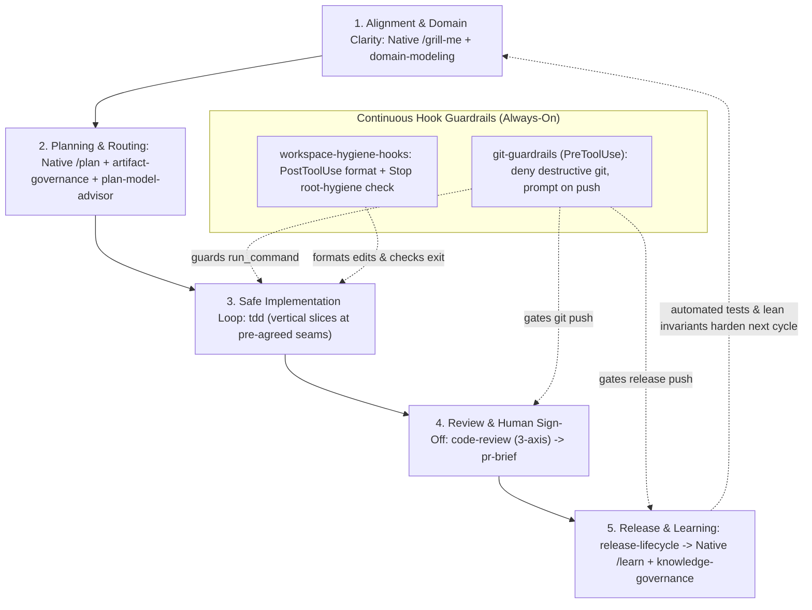

# Agentic Pair Programming Protocol

A practical, end-to-end guide to pairing with **Google Antigravity** using the **20 à la carte plugins** in [`antigravity-customizations`](../README.md) (**8 core lifecycle skills**, **2 always-on guardrail hook plugins**, and **10 situational skills**) alongside Antigravity's native slash commands (`/grill-me`, `/plan`, `/teamwork`, `/compact`, `/learn`).

Every plugin is **standalone and optional**—if you omit a plugin at any stage, the remaining stages degrade cleanly without failing. Think of this document as the **reference choreography** showing how the pieces reinforce one another across a full feature lifecycle.

> **How Plugins Trigger & Where Files Live**
> * **Triggering:** Native slash commands (`/grill-me`, `/plan`, `/teamwork`, `/compact`, `/learn`) are typed directly in chat. **Skills** activate automatically when your prompt matches their description, explicitly when you name them in chat (e.g., *"Run `code-review` since `main`"*), or via their **`suggestedPrompts`** chips in Antigravity's UI. **Hook plugins** (`git-guardrails`, `workspace-hygiene-hooks`) run automatically on matching tool calls with zero prompting.
> * **Session Artifacts vs. Repo Files:** `implementation_plan.md`, `walkthrough.md`, `handoff_<slug>.md`, and Antigravity's per-session scratch directory are **Antigravity Session Artifacts** (managed automatically per conversation outside your git repo). Within a multi-milestone conversation (staying in one chat with `/compact` or offloading slices to `/teamwork`), `implementation_plan.md` and `walkthrough.md` act as cumulative append-only ledgers; when context grows heavy or you switch models, [`session-handoff`](../plugins/session-handoff/README.md) passes the exact absolute path to the prior conversation's plan artifact so the new chat can read it while maintaining its own fresh ledger (or teams commit long-lived plans under `docs/`). Files like `AGENTS.md`, `GLOSSARY.md`, `CODING_STANDARDS.md`, `docs/adr/`, `CHANGELOG.md`, and `ROADMAP.md` live **inside your git repository**.
> * For upstream attribution (`mattpocock/skills`, `humanlayer/show-me`) and why specific patterns diverge, see [Upstream Adaptations & Deviations](./upstream-adaptations-and-deviations.md).

---

## Standard Feature Lifecycle at a Glance

---

## The 5-Stage Standard Loop

### Stage 1: Alignment & Domain Clarity

**Goal:** Eliminate requirement ambiguity and lock down shared vocabulary before writing a plan or a line of code.

* **Native `/grill-me`:** Type `/grill-me` followed by your feature idea so Antigravity interviews you relentlessly until every branch of the design tree is resolved. Keep the agent in an **explore-first** habit (reinforced when `domain-modeling` activates—or remind the agent to inspect the codebase before asking factual questions the code can answer).
* **Optional [`domain-modeling`](../plugins/domain-modeling/README.md):** Once enabled, Antigravity can activate this skill when you discuss domain terminology, edit `GLOSSARY.md`, or debate an irreversible trade-off—or trigger it explicitly to be sure (e.g., *"Use `domain-modeling` to sharpen these terms and record an ADR if warranted"*):
  * **Glossary updates:** The agent creates or updates `GLOSSARY.md` incrementally on demand using pure domain language (zero implementation details, table names, or framework jargon).
  * **Creating an ADR (Architecture Decision Record):** You do **not** hand-format ADRs. Ask the agent *"Record this trade-off as an ADR"* (or accept when `domain-modeling` offers one). It checks its 3-criteria gate—*hard to reverse* + *surprising without context* + *result of a real trade-off*—and writes an immutable `docs/adr/NNNN-<slug>.md` file using its bundled [`adr-format.md`](../plugins/domain-modeling/skills/domain-modeling/references/adr-format.md) template. *(Live, enforceable system rules belong in `AGENTS.md` or automated tests—see Stage 5—rather than ADRs.)*

**Exit criteria:** Every open design question is resolved, domain terms match `GLOSSARY.md`, and any hard-to-reverse trade-off has an ADR.

---

### Stage 2: Planning & Execution Routing

**Goal:** Produce a durable, right-sized implementation plan and pick the optimal model, thinking effort, and concurrency topology *before* editing code.

* **Draft the Plan (Native `/plan` + [`artifact-governance`](../plugins/artifact-governance/README.md)):**
  * **How to use it:** Type `/plan` (or ask Antigravity to draft an implementation plan). Once `artifact-governance` is enabled, it activates on matching requests involving `implementation_plan.md`, `walkthrough.md`, research notes, or scratch scripts—or name it explicitly when you want deterministic enforcement (e.g., *"Append Milestone 2 to `implementation_plan.md` using `artifact-governance`"*).
  * **What it enforces:**
    * Distinguishes **Living Documents** (actively maintained single sources of truth like `implementation_plan.md` and `walkthrough.md`) from **Historical Artifacts** (frozen point-in-time snapshots like ADRs, incident post-mortems, or benchmark logs). Within a multi-milestone session, `implementation_plan.md` and `walkthrough.md` act as **append-only cumulative ledgers**—reading the tail to find Milestone `M` and appending `# Milestone M+1` rather than overwriting earlier milestones.
    * Routes independent follow-up audits or remediation tracks into dedicated Session Artifacts instead of clobbering the main plan.
    * Captures external research in cited primary-source Markdown notes (saved as Session Artifacts or committed under `docs/`), and places one-off helper scripts in the session scratch directory rather than inline `python -c` shell blobs.
* **Execution Brief ([`plan-model-advisor`](../plugins/plan-model-advisor/README.md)):**
  * **How to use it:** Ask *"Review `implementation_plan.md` with `plan-model-advisor`"* (or add a global preference in `~/.gemini/GEMINI.md`—see the [README](../README.md#keeping-personal-preferences-decoupled)—so it runs automatically before executing every plan). It auto-refreshes its live model catalog, scores each phase against your profile (`quality-first`, `balanced`, or `quota-saver`), flags surgical edits where heavy reasoning models over-engineer, and outputs a **Model & Swarm Execution Brief**. To apply single-agent recommendations, switch Antigravity's model/effort selector in the chat toolbar (or start a fresh chat via `session-handoff` if switching model families).
  * **Context-Window Slicing (~150k tokens):** Splits oversized monolithic phases into bite-sized vertical tracer-bullet (thin end-to-end) slices so each session stays sharp without attention drift.
  * **Swarm Execution (`/teamwork` / `swarm`):** Recommends either a **parallel-slice swarm** (multiple authors owning non-overlapping files along the **task-graph frontier**—the unblocked tasks ready to run in parallel) or a **2-worker adversarial swarm** (one `author` plus a cold-start cross-family `verifier` attacking the author's code). It outputs a ready-to-paste `/teamwork` launch prompt naming sparse context pointers (file paths and line ranges), per-worker model pins, and Antigravity workspace modes—`workspace: "share"` (gives each concurrent author its own isolated working copy sharing the repo's git store, like `git worktree`) and `workspace: "inherit"` (uses the coordinator's workspace, ideal for read-only verifiers that inspect an author's committed branch/worktree before the coordinator merges it)—which Antigravity's swarm coordinator applies automatically.

**Exit criteria:** Milestone appended cleanly to `implementation_plan.md`; model, effort tier, slice boundaries, and swarm ownership approved by the user.

---

### Stage 3: Safe Implementation Loop

**Goal:** Build each vertical slice with tight, deterministic feedback loops while always-on hooks eliminate catastrophic git mistakes and workspace mess.

* **Vertical-Slice Seam TDD ([`tdd`](../plugins/tdd/README.md)):**
  * **How to use it:** Ask *"Implement Milestone 2 using `tdd`"* (or pass `tdd` in your `/teamwork` worker brief).
  * **Agree on seams first:** Before writing tests, the agent lists candidate public seams (stable entry points such as HTTP handlers, CLI commands, or module interfaces—with what each catches and misses) so you confirm where behavior is tested.
  * **Red → Green → Refactor, one vertical slice at a time:** Rejects horizontal "write all tests first" batches, implementation-coupled mocks, tautological assertions, and test-file helper stand-ins that re-implement production logic instead of exercising real handlers/validators.
  * **Hermetic Testing Boundary:** Keeps tests fast, offline, and deterministic (pinned clocks, seeded RNG, isolated temp dirs, narrow in-memory fakes only at external system boundaries).
* **Continuous Hook Guardrails (Always-On — No Prompting Needed):**
  * **[`git-guardrails`](../plugins/git-guardrails/README.md) (`PreToolUse`):** Automatically intercepts `run_command` to **`deny`** destructive git ops (e.g., `push --force`/`--force-with-lease`/`--mirror`, `reset --hard`, `clean -f`, `branch -D`, `checkout .`, `restore .`) and **`force_ask`** (always prompt, ignoring cached approvals) on every standard `git push`. Because Antigravity's standard sandbox auto-runs workspace commands while unsandboxed calls (`BypassSandbox: true`) require approval—and returning `allow` from a hook bypasses prompts—it returns `allow` on non-destructive sandboxed commands (matching normal sandbox auto-run) and `ask` on unsandboxed calls so your approval prompts and "Always Allow" cache stay intact. *(Assumes Antigravity's default auto-run sandbox; omit this plugin if you disable sandbox auto-run and require manual approval on every sandboxed command.)*
  * **[`workspace-hygiene-hooks`](../plugins/workspace-hygiene-hooks/README.md) (`PostToolUse` + `Stop`):** Silently runs installed formatters (`ruff`, `prettier`, `gofmt`, `rustfmt`) on edited workspace files after writes (`PostToolUse`) and prompts the agent before turn exit if stray scratch scripts or log files remain in the repo root (`Stop`, with a one-retry loop guard).

**Exit criteria:** All slices green at real seams, local QA (your repo's test/lint suite, e.g., `just check`) passes, and working tree is clean on a feature branch.

---

### Stage 4: Review & Human Sign-Off (*Mk1 Eyeball* Gate)

**Goal:** Catch standards drift, spec mismatches, fake/mocked behavior, and security flaws with fresh eyes—then hand the human reviewer a visual brief they can verify in minutes.

* **3-Axis Parallel Diff Review ([`code-review`](../plugins/code-review/README.md)):**
  * **How to use it:** Ask *"Run `code-review` since `main`"* (or any commit/tag/branch). By default it inspects committed changes (`git diff <fixed-point>...HEAD`) and discovers `implementation_plan.md` or matching `docs/` specs automatically—commit work-in-progress first (or ask it to include uncommitted working-tree changes), and pass an explicit spec path if running from a fresh session.
  * Spawns three fresh, read-only Antigravity subagents (`invoke_subagent`) in parallel and presents their reports side by side **without merging or reranking**:
    1. **Axis 1 — Standards:** Documented repo standards (automatically reading optional `CODING_STANDARDS.md`—a review-only file kept out of implementer context—plus `CONTRIBUTING.md` and `AGENTS.md`) alongside the 12 Fowler Code Smells baseline (skipping mechanical rules already enforced by linters).
    2. **Axis 2 — Spec + Reality Check:** Verifies every requirement against the plan/spec (missing work, scope creep, wrong behavior) AND runs a **Zero-Mock / Reality-Check lens** hunting fake/stubbed production behavior (hardcoded mock responses, silent synthetic fallbacks, swallowed errors, test-file stand-ins, and unverified doc claims—distinct from legitimate external-boundary fakes in unit tests).
    3. **Axis 3 — Security:** Audits concrete exploitable weaknesses (auth/trust boundaries, fail-open guards, injection & unsafe DOM sinks, SSRF, secrets/crypto, concurrency races, CI/hook bypasses; gracefully skips pure-prose diffs).
* **Session Record (`walkthrough.md`) & Visual-First PR Brief ([`pr-brief`](../plugins/pr-brief/README.md)):**
  * **How they differ:** Have the agent append full verification evidence (commands run, test counts, review findings) to the session's `walkthrough.md` ledger (`artifact-governance`) as your detailed session record, then ask *"Draft a PR description with `pr-brief`"* to distill it into a crisp external PR brief (copy-ready Markdown for your approval first, optionally creating/updating the PR via authenticated `gh` CLI once you confirm).
  * Structures the **Mk1 Eyeball** *(human visual inspection)* brief into three concise sections:
    1. **`## Summary`:** The smallest clarifying visual (pseudocode, call/file/component tree, Mermaid diagram, or scoped diff) beside minimal prose.
    2. **`## Evidence`:** Concrete Before/After proof (screenshots/DOM captures for visual changes, or failing→passing test logs, validator runs, and live staging probes—all with `<REDACTED>` secret hygiene) plus a 2–4 step human walkthrough checklist.
    3. **`## Merge Danger`:** Explicit **One-Way Door** (hard to reverse) vs. **Two-Way Door** (cheap to roll back) classification and concrete **Blast Radius**.

**Exit criteria:** All blocking findings across Standards, Spec, and Security resolved; human completes Mk1 Eyeball (visual) sign-off from the PR brief.

---

### Stage 5: Release & Continuous Learning

**Goal:** Ship cleanly with repeatable release hygiene, then feed hard-won lessons into the lowest-cost tier so the next session starts smarter without bloating agent context.

* **4-Phase Delivery Cadence ([`release-lifecycle`](../plugins/release-lifecycle/README.md)):**
  * **How to use it:** Ask *"Walk through `release-lifecycle` for `vX.Y.0`."* *(For tagless continuous-deployment repos that merge straight to `main` without version tags, skip `release-lifecycle` and run `/learn` + `knowledge-governance` right after merging.)*
  * **How it connects to Stages 3–4:** `release-lifecycle` wraps the whole release end-to-end—its Phase 1 (`Local QA → Branch/PR & staging/dev verification → Mk1 Eyeball sign-off`) corresponds directly to Stages 3–4 above. If you already completed Stages 3–4, `release-lifecycle` picks up cleanly at **Phase 2 (Feature Version Release: sync `CHANGELOG.md` and `ROADMAP.md` if present, commit, tag, and push/publish)** → **Phase 3 (Native `/learn` Retrospective)** → **Phase 4 (Optional Lean Patch Release: shipping newly codified tests, lint checks, or doc fixes as a fast `vX.Y.1` patch; skipped if `/learn` produced no repo changes)**.
  * Checks which local tools and files exist (`gh`, `ROADMAP.md`, CI/CD workflows) and skips missing steps cleanly, and enforces **Topological Multi-Repo PR Merge Order** (merge upstream contract/content repos before downstream deploy pipelines that consume them).
* **Continuous Learning & Demotion (Native `/learn` + [`knowledge-governance`](../plugins/knowledge-governance/README.md)):**
  * **How to use it:** Type Antigravity's native `/learn` after a release to propose persisting session lessons; when `knowledge-governance` is enabled, it activates on matching `/learn` or retrospective prompts to run the 7-category retro and Admission Gate—or name it explicitly in chat (*"Run a `knowledge-governance` retrospective on this session"*).
  * Audits the session across **7 diagnostic categories** (`Navigation`, `Automated checks`, `Coding standards`, `Steering files (AGENTS.md & ~/.gemini/GEMINI.md)`, `Tool economy`, `No-ops` [instructions the model already follows by default], `Information access`), ranked by severity.
  * Routes every proposed rule through the **`/learn` Admission Gate** (*"Why not a test? Why not a skill? Does it fit the 800-token budget?"*) and the **4-Tier Knowledge Taxonomy**:
    * **Tier 0 (`AGENTS.md`, strictly `<800` tokens):** Universal invariants organized internally by `knowledge-governance` into three severity groups (**Class α** Safety & Human Authority, **Class β** Execution & Release Lifecycle, **Class γ** Ergonomics & Governance).
    * **Tier 1 (Progressive Skills):** Subsystem-scoped runbooks loaded only on demand.
    * **Tier 2 (Automated Tests & Linters):** Primary destination of the **Demotion Highway** (*"If a machine can assert it deterministically in <0.3s, never waste prompt tokens on it"*).
    * **Tier 3 (`docs/`):** Deep specs, architecture designs, and reference manuals.
    * **Optional Review-Only Bridge (`CODING_STANDARDS.md`):** Lives at your repo root; because Antigravity only auto-loads `AGENTS.md` among repo-root Markdown files, `CODING_STANDARDS.md` costs zero implementer tokens and is read *only* when `code-review` runs.
  * Periodically audit aging rules with the **Invariant Challenger** (ask *"Challenge our `AGENTS.md` invariants with `knowledge-governance`"* to score each rule as `PRESERVE`, `DEMOTE` to tests, `AMEND`, or `NULLIFY` [moves the invariant to `Retired`—removed from `AGENTS.md` and archived with rationale in `docs/`]).

**Exit criteria:** Release tagged/verified, `CHANGELOG.md` (and `ROADMAP.md` if used) synced, and retrospective lessons demoted into tests, skills, or trimmed invariants.

---

## When to Use Situational Skills

Reach for these **10 situational plugins** whenever a specific symptom appears—invoke any of them by naming the plugin in chat (or letting Antigravity auto-trigger it from your prompt).

| Symptom / Trigger | Plugin | Where It Plugs In | How to Invoke & What It Does |
| :--- | :--- | :--- | :--- |
| Hard bug, intermittent flake, or latency regression where guessing wastes turns | [`diagnosing-bugs`](../plugins/diagnosing-bugs/README.md) | **Any stage** (replaces ad-hoc debugging) | *"Diagnose this failure with `diagnosing-bugs`."* Enforces a 6-phase loop: tight failing reproduction loop first → minimise → 3–5 falsifiable hypotheses → `[DEBUG-xxxx]` probes → seam regression test → cleanup + `<REDACTED>` hygiene (includes a guided bash loop script when only a human can trigger the bug). |
| Codebase hotspots feel tangled, shallow pass-through wrappers multiply, or a file crosses ~500 LOC | [`architecture-review`](../plugins/architecture-review/README.md) | **Before Stage 1/2** or periodically between milestones | *"Run `architecture-review` on recent hotspots."* Surveys `git log` churn hotspots using Ousterhout Deep Modules (*rich behavior behind a small interface*) + the *Deletion Test* (checking whether deleting a module pushes complexity out to callers rather than simply removing a shallow pass-through) + ~500 LOC internal split harmony, runs parallel `invoke_subagent` *Design-It-Twice* comparisons (designing 2+ alternative interfaces in parallel to compare trade-offs), renders Antigravity Mermaid Artifacts, and checks optional stack-conditional guardrails (safe DOM sinks, browser/Playwright checks, modular Justfiles). |
| Suspicion of "echo-chamber drift", vaporware dashboards, hardcoded telemetry, or stale docs across a repo | [`reality-check-audit`](../plugins/reality-check-audit/README.md) | **Between milestones** (open a fresh chat on another model family, e.g., Claude ↔ Gemini) | *"Run a `reality-check-audit` on this repo."* Produces an adversarial outsider report: *What's Genuinely Good → What's Concerning → What's Aspirational vs. Real → Concrete Remediation Plans*. |
| Documentation, READMEs, or onboarding guides feel dense with internal jargon or unclear to newcomers | [`fresh-reader`](../plugins/fresh-reader/README.md) | **Stage 4 or Stage 5** (before publishing docs) | *"Run `fresh-reader` on `README.md` and `docs/`."* Spawns a zero-context read-only subagent (`invoke_subagent`) to review docs as a first-time visitor, triages 100% of findings with discernment (`ACCEPT`, `LINK` to existing docs, or `WON'T DO`), and re-verifies edits until a pass yields zero new changes. Pairs naturally with `domain-modeling` to stress-test `GLOSSARY.md` and capture missing domain terms. |
| Context window is filling up, or you want to move work to a fresh session / different model family | [`session-handoff`](../plugins/session-handoff/README.md) | **Any stage boundary** (complements `/compact`, which summarizes in-place inside the same chat) | *"Create a `session-handoff` artifact for a fresh Claude session."* Writes a sparse, absolute-path `handoff_<slug>.md` artifact with live git state, settled decisions, ruled-out dead ends, verification status, and a copy-ready starter prompt you paste into a new chat (after switching Antigravity's model picker or opening another local CLI agent). |
| Fresh workspace or reset permissions causing repetitive approval popups on unsandboxed or IDE-prompted read commands | [`bootstrap-approvals`](../plugins/bootstrap-approvals/README.md) | **Before Stage 1** (workspace setup) | *"Run `bootstrap-approvals` for this workspace."* Discovers safe read-only commands (`Justfile`, `Makefile`, `git`, `gh`) that trigger approval popups outside the auto-run sandbox, confirms the list with you, and runs each discrete top-level `run_command` one by one so you can click **"Always Allow"** in a single pass—strictly banning mutating *"Spicy Prefixes"* like `git reset` or `rm`. |
| Starting a brand-new repository that lacks `AGENTS.md`, `Justfile`, `GLOSSARY.md`, or governance tests | [`repo-bootstrap`](../plugins/repo-bootstrap/README.md) | **Day 0** (optional, never required) | *"Run `repo-bootstrap` on this repo."* Probes local tool readiness (`git`, `gh`, `just`, `python3`, linters) and scaffolds only the governance files you opt into without overwriting existing files (including automated governance test placeholders verifying docs, schemas, and invariants). |
| Authoring, auditing, or pruning a `SKILL.md`, `plugin.json`, `AGENTS.md`, or `hooks.json` | [`writing-for-agents`](../plugins/writing-for-agents/README.md) | **Stage 5** (or plugin authoring) | *"Audit this `SKILL.md` with `writing-for-agents`."* Applies prompt-craft levers (context pointers, high-signal trigger words, positive phrasing, pruning no-op instructions the model already follows by default) alongside Antigravity's exact manifest, frontmatter, root `hooks.json`, and `<800`-token rules. |
| Uncertain UX flow or tricky state-machine logic that is faster to feel interactively than debate in prose | [`prototype`](../plugins/prototype/README.md) | **Stage 1** (during `/grill-me`) | *"Build a throwaway `prototype` to compare 3 layout options."* Creates a single-file HTML logic demo or toggleable UI variations via Antigravity Artifacts or `generative_ui` (Antigravity's interactive HTML widget renderer). |
| Feature requires human-only provisioning, third-party dashboard clicks, CI secrets, or a one-off cutover | [`wizard`](../plugins/wizard/README.md) | **Stage 3 or Stage 5** (ops handoff) | *"Generate a `wizard` script for provisioning these secrets."* Builds an interactive bash runbook (`[y/N]` confirm gates, silent `read -rs` secret prompts, idempotent `0600` `.env` upserts, `gh` secret/variable writes with fallback, and a summary of remaining manual steps). |

---

## Worked Example: End-to-End Feature Walkthrough

**Scenario:** Adding HMAC webhook signature verification and replay-window idempotency to a billing service (`billing-api`).

1. **Stage 1 — Alignment (Native `/grill-me` + `domain-modeling`):**
   * You type `/grill-me` with your webhook spec. Exploring `billing-api` first, the agent sees webhooks currently enter through `POST /webhooks/stripe` without timestamp bounds and asks 4 sharp questions (clock skew tolerance, key rotation overlap, idempotency TTL, dead-letter behavior).
   * Because `domain-modeling` is enabled, it updates `GLOSSARY.md` on demand with **Replay Window** and **Idempotency Receipt** (pure domain concepts, no Redis key names). When you agree on a dual-signing header contract, you tell the agent *"Record this as an ADR"*, and it writes `docs/adr/0007-hmac-dual-key-rotation.md`.
2. **Stage 2 — Planning (Native `/plan` + `artifact-governance` + `plan-model-advisor`):**
   * You type `/plan` to capture the agreed design (continuing an ongoing multi-milestone session that already finished Milestones 1–3). `artifact-governance` automatically reads the tail of `implementation_plan.md` and appends `# Milestone 4: Webhook Verification & Idempotency` without touching Milestones 1–3.
   * You ask *"Review `implementation_plan.md` with `plan-model-advisor`."* Under your `quality-first` profile, it flags crypto verification + persistence as security-critical, confirms the two compact vertical slices (Slice A: signature & replay verifier; Slice B: idempotency store & HTTP handler wiring) fit together inside a single sharp ~150k-token budget, and outputs a ready-to-paste `/teamwork` launch prompt for a **2-worker adversarial swarm** (one `author` on `workspace: "share"` implementing Slice A then Slice B via `tdd`, paired with a cold-start cross-family `verifier` on `workspace: "inherit"` attacking each slice). *(For larger features where two slices touch disjoint files, `plan-model-advisor` recommends two parallel `author` workers instead so each stays under ~150k tokens.)*
3. **Stage 3 — Implementation (`/teamwork` + `tdd` + `git-guardrails` + `workspace-hygiene-hooks`):**
   * You paste the `/teamwork` launch prompt. For Slice A and then Slice B, the `author` worker implements against the public HTTP webhook handler seam (`POST /webhooks/stripe` with injected clock and in-memory receipt store) agreed during Stage 2 (or confirmed via the swarm coordinator before writing the first test).
   * One vertical slice at a time: Slice A locks down invalid HMAC → minimal constant-time verifier → expired timestamp → minimal replay window; Slice B locks down duplicate event ID → minimal idempotency receipt. No mocked crypto helpers or test-file stand-ins. As each slice commits on `author`'s worktree branch, `verifier` inspects those commits directly via git (from `workspace: "inherit"`) and signs off before the swarm coordinator merges the branch into your feature branch.
   * In the background, `workspace-hygiene-hooks` auto-formats saved files (`PostToolUse`) and checks that zero scratch scripts remain in the repo root on exit (`Stop`); `git-guardrails` lets local commits flow freely while blocking accidental `git reset --hard` or unconfirmed pushes.
4. **Stage 4 — Review & Sign-Off (`code-review` + `walkthrough.md` + `pr-brief`):**
   * You prompt *"Run `code-review` since `main`."* Three parallel subagents inspect `git diff main...HEAD`:
     * `## Standards` flags a long parameter list smell in the verifier config.
     * `## Spec` confirms all 4 requirements match Milestone 4 and zero hardcoded fallbacks exist.
     * `## Security` catches a fail-open branch when `WEBHOOK_SECRET_NEXT` is set to an empty string—fixed immediately with a real-handler regression test.
   * The agent appends full test and probe outputs to `walkthrough.md`, then you prompt *"Draft the PR with `pr-brief`."* It distills that record into a 6-node Mermaid request flow (`## Summary`), failing→passing test logs plus a live staging `curl` verification with `<REDACTED>` signature headers (`## Evidence`), a 3-step Mk1 Eyeball (human visual) checklist, and a **Two-Way Door** assessment (feature-flagged dual-key verifier, rollback via env toggle). You complete your visual sign-off and open the PR.
5. **Stage 5 — Release & Learning (`release-lifecycle` + Native `/learn` + `knowledge-governance`):**
   * After merging the PR, you prompt *"Run `release-lifecycle` for `v1.4.0`."* Since Stages 3–4 already completed local QA, staging verification, and visual sign-off, it moves straight to Phase 2—syncing `CHANGELOG.md` (and `ROADMAP.md` if present), tagging `v1.4.0`, and prompting before `git push` (reinforced by `git-guardrails`).
   * You type `/learn`. `knowledge-governance` runs the 7-category retro and reflects on Stage 4's empty-string `WEBHOOK_SECRET_NEXT` bug. Instead of adding a prose rule to `AGENTS.md`, the *Demotion Highway* generalizes Stage 4's point fix into a **Tier 2** startup-config unit test (`<0.1s`) asserting *no* required secret env var accepts an empty string—shipped immediately in an optional lean `v1.4.1` patch release while keeping `AGENTS.md` well under its 800-token ceiling.

---

## See Also

* [Repository README & Quick Start](../README.md) — À la carte installation, Starter Pack, and invocation guide.
* [Upstream Adaptations & Deviations](./upstream-adaptations-and-deviations.md) — Provenance matrix across all 20 plugins, architectural rationale, and upstream triage notes.
