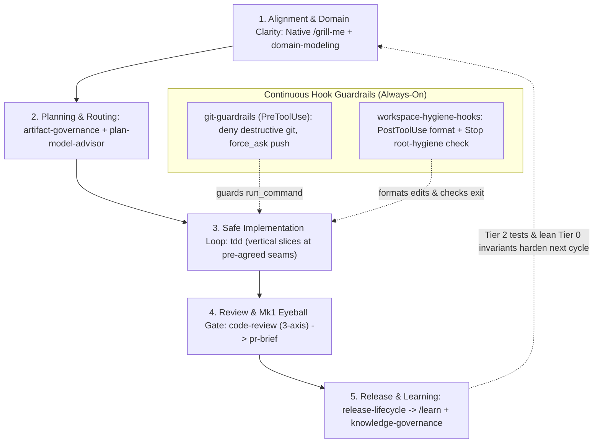

# Agentic Pair Programming Protocol

A practical, end-to-end guide to pairing with **Google Antigravity** using the 19 à la carte plugins in [`antigravity-customizations`](../README.md) alongside Antigravity's native slash commands (`/grill-me`, `/plan`, `/teamwork`, `/compact`, `/learn`).

Every plugin is **standalone and optional**—if you omit a plugin at any stage, the remaining stages degrade cleanly without failing. Think of this document as the **reference choreography** showing how the pieces reinforce one another across a full feature lifecycle.

> For our upstream attribution to `mattpocock/skills` and `humanlayer/show-me`—and why specific patterns diverge—see [Upstream Adaptations & Deviations](./upstream-adaptations-and-deviations.md).

---

## Standard Feature Lifecycle at a Glance

---

## The 5-Stage Standard Loop

### Stage 1: Alignment & Domain Clarity

**Goal:** Eliminate requirement ambiguity and lock down shared vocabulary before writing a plan or a line of code.

* **Native `/grill-me`:** Have Antigravity interview you relentlessly until every branch of the design tree is resolved. Follow the **explore-first** rule—expect the agent to read the codebase for factual answers instead of asking you questions the code can answer.
* **Optional [`domain-modeling`](../plugins/domain-modeling/README.md):** Whenever a feature introduces new domain concepts, ambiguous jargon, or an irreversible architectural trade-off:
  * Update `GLOSSARY.md` lazily and inline (pure domain language—zero implementation details, table names, or framework jargon).
  * Record an immutable **Historical ADR** under `docs/adr/NNNN-*.md` **only** when all three gates hold: *hard to reverse* + *surprising without context* + *result of a real trade-off*. (Live enforceable rules belong in Stage 5's Invariants, not ADRs.)

**Exit criteria:** Every open design question is resolved, domain terms match `GLOSSARY.md`, and any hard-to-reverse trade-off has an ADR.

---

### Stage 2: Planning & Execution Routing

**Goal:** Produce a durable, right-sized implementation plan and pick the optimal model, thinking effort, and concurrency topology *before* editing code.

* **Plan Ledger ([`artifact-governance`](../plugins/artifact-governance/README.md)):**
  * Classify `implementation_plan.md` and `walkthrough.md` as **Living Documents** (*"It's alive!"*) maintained as **append-only cumulative ledgers** across a release epoch—always read the tail to find Milestone $M$ and append `# Milestone M+1` rather than blind-overwriting prior milestones.
  * Route independent follow-up audits or remediation tracks to dedicated topic artifacts.
  * Capture external research in cited primary-source Markdown notes, and put any one-off helper scripts in the scratch directory rather than inline `python -c` blobs.
* **Execution Brief ([`plan-model-advisor`](../plugins/plan-model-advisor/README.md)):**
  * Run `plan-model-advisor` against `implementation_plan.md` before starting implementation. It refreshes its live model catalog automatically, scores each phase against your profile (`quality-first`, `balanced`, or `quota-saver`), flags surgical steps where frontier models over-engineer, and outputs a **Model & Swarm Execution Brief**.
  * **Context-Window Slicing (~150k tokens):** Split oversized monolithic phases into vertical tracer-bullet slices that fit comfortably inside a single focused context window to prevent attention drift.
  * **Parallel Execution (`/teamwork` / `swarm`):** When slices have non-overlapping file ownership, use the brief's task-graph frontier, sparse context pointers (file paths and line ranges, never pasted prose), and per-worker model pins (`workspace: "share"` for concurrent authors; `workspace: "inherit"` for read-only verifiers).

**Exit criteria:** Milestone appended cleanly to `implementation_plan.md`; model, effort tier, slice boundaries, and swarm ownership approved by the user.

---

### Stage 3: Safe Implementation Loop

**Goal:** Build each vertical slice with tight, deterministic feedback loops while automated hooks eliminate catastrophic git mistakes and workspace mess.

* **Vertical-Slice Seam TDD ([`tdd`](../plugins/tdd/README.md)):**
  * **Agree on seams first:** Before writing tests, list candidate public seams (with what each catches and misses) and align on where behavior is tested.
  * **Red → Green → Refactor, one vertical slice at a time:** Reject horizontal "write all tests first" batches, implementation-coupled mocks, tautological assertions, and test-file helper stand-ins that re-implement production logic instead of exercising real handlers/validators.
  * **Hermetic Testing Boundary:** Keep tests fast, offline, and deterministic (pinned clocks, seeded RNG, isolated temp dirs, narrow in-memory fakes only at external system boundaries).
* **Continuous Hook Guardrails (Always-On):**
  * **[`git-guardrails`](../plugins/git-guardrails/README.md) (`PreToolUse`):** Automatically intercepts `run_command` to **`deny`** destructive git commands (`push --force`/`--mirror`, `reset --hard`, `clean -f`, `branch -D`, `checkout .`, `restore .`), **`force_ask`** on every standard `git push`, **`allow`** routine sandboxed local commits/reads, and **`ask`** on unsandboxed non-git commands so cached approvals stay safe.
  * **[`workspace-hygiene-hooks`](../plugins/workspace-hygiene-hooks/README.md) (`PostToolUse` + `Stop`):** Silently runs installed formatters (`ruff`, `prettier`, `gofmt`, `rustfmt`) on edited workspace files after writes (`PostToolUse`) and catches stray scratch scripts or log files left in the repo root before the agent finishes (`Stop`).

**Exit criteria:** All slices green at real seams, local QA (`just check` / test suite) passes, and working tree is clean on a feature branch.

---

### Stage 4: Review & Mk1 Eyeball Gate

**Goal:** Catch standards drift, spec mismatches, fake/mocked behavior, and security flaws with fresh eyes—then hand the human reviewer a visual brief they can verify in minutes.

* **3-Axis Parallel Diff Review ([`code-review`](../plugins/code-review/README.md)):**
  Spawns three fresh, read-only Antigravity subagents (`invoke_subagent`) in parallel against `git diff <fixed-point>...HEAD` and presents their reports side by side **without merging or reranking**:
  1. **Axis 1 — Standards:** Documented repo standards (automatically reading optional review-only `CODING_STANDARDS.md`, `CONTRIBUTING.md`, `AGENTS.md`) plus the 12 Fowler Code Smells baseline (skipping mechanical rules already enforced by linters).
  2. **Axis 2 — Spec + Reality Check:** Verifies every requirement against the plan/spec (missing work, scope creep, wrong behavior) AND runs a **Zero-Mock / Reality-Check lens** hunting hardcoded mocks, synthetic fallbacks, swallowed errors, test-file stand-ins, and unverified doc claims.
  3. **Axis 3 — Security:** Audits concrete exploitable weaknesses (auth/trust boundaries, fail-open guards, injection & unsafe DOM sinks, SSRF, secrets/crypto, concurrency races, CI/hook bypasses; gracefully skips pure-prose diffs).
* **Visual-First Walkthrough ([`pr-brief`](../plugins/pr-brief/README.md)):**
  Generates the PR body and **Mk1 Eyeball Review** checklist (via authenticated `gh` CLI or offline copy-ready Markdown):
  1. **`## Summary`:** The smallest clarifying visual (pseudocode, call/file/component tree, Mermaid diagram, or scoped diff) beside minimal prose.
  2. **`## Evidence`:** Before/After proof (S-tier screenshots/DOM captures or A-tier failing→passing tests, validator runs, live dev probes—all with `<REDACTED>` secret hygiene) plus a 2–4 step Mk1 Eyeball walkthrough checklist.
  3. **`## Merge Danger`:** Explicit **One-Way Door** vs. **Two-Way Door** classification and concrete **Blast Radius**.

**Exit criteria:** All blocking findings across Standards, Spec, and Security resolved; human completes Mk1 Eyeball sign-off from the PR brief.

---

### Stage 5: Release & Continuous Learning

**Goal:** Ship cleanly with repeatable release hygiene, then feed hard-won lessons into the lowest-cost tier so the next session starts smarter without bloating agent context.

* **4-Phase Delivery Cadence ([`release-lifecycle`](../plugins/release-lifecycle/README.md)):**
  * Guides **Phase 1 (Local QA → Branch/PR & Dev Probe → Mk1 Eyeball Sign-Off)** → **Phase 2 (Feature Version Release)** → **Phase 3 (`/learn` Retrospective)** → **Phase 4 (Lean Patch Release)**.
  * Maintains `CHANGELOG.md` (what shipped) vs. `ROADMAP.md` (what remains) symmetry, degrades cleanly via **self-contained graceful preflight** when `gh` or CI/CD workflows are absent, and enforces **Topological Multi-Repo PR Merge Order** (merge upstream contract/content repos before downstream deploy pipelines that consume them).
* **Continuous Learning & Demotion (Native `/learn` + [`knowledge-governance`](../plugins/knowledge-governance/README.md)):**
  * Run a session retrospective across the **7 diagnostic categories** (`Navigation`, `Automated checks`, `Coding standards`, `Global AGENTS.md`, `Tool economy`, `No-ops`, `Information access`), ranked by severity.
  * Route every proposed rule through the **`/learn` Admission Gate** and **4-Tier Knowledge Taxonomy**:
    * **Demotion Highway first:** *"If a machine can assert it deterministically in <0.3s, never waste prompt tokens on it."* Prefer a **Tier 2** test/linter over prose.
    * Scope subsystem workflows to **Tier 1** progressive skills, repo-wide judgement calls to optional review-only **Tier 1.5** (`CODING_STANDARDS.md`), and reserve **Tier 0** (`AGENTS.md`, strictly `<800` tokens) for universal Class α/β/γ invariants.
    * Audit aging rules with the **Invariant Challenger** (`PRESERVE` / `DEMOTE` / `AMEND` / `NULLIFY`).

**Exit criteria:** Release tagged/verified, `CHANGELOG.md` and `ROADMAP.md` synced, and retrospective lessons demoted into tests, skills, or trimmed invariants.

---

## When to Use Situational Skills

Reach for these **9 situational plugins** whenever a specific symptom appears—they plug directly into the 5-stage loop without adding overhead to routine features.

| Symptom / Trigger | Plugin | Where It Plugs In | What It Does |
| :--- | :--- | :--- | :--- |
| Hard bug, intermittent flake, or latency regression where guessing wastes turns | [`diagnosing-bugs`](../plugins/diagnosing-bugs/README.md) | **Before Stage 3** (replaces ad-hoc debugging) | Enforces a 6-phase loop: tight red-capable feedback loop first → reproduce/minimise → 3–5 falsifiable hypotheses → `[DEBUG-xxxx]` probes → seam regression test → cleanup + `<REDACTED>` hygiene. |
| Codebase hotspots feel tangled, shallow pass-through wrappers are multiplying, or a file crosses ~500 LOC | [`architecture-review`](../plugins/architecture-review/README.md) | **Before Stage 1/2** or periodically between milestones | Surveys `git log` hotspots using Ousterhout Deep Modules + ~500 LOC internal decomposition harmony, runs parallel `invoke_subagent` Design-It-Twice comparisons, renders Antigravity Mermaid Artifacts, and audits DOM/Playwright/Justfile operational guardrails. |
| Suspicion of "echo-chamber drift", vaporware dashboards, hardcoded telemetry, or stale documentation across a whole repo | [`reality-check-audit`](../plugins/reality-check-audit/README.md) | **Between milestones** (ideally cross-family model) | Runs an adversarial outsider audit structured as *What's Genuinely Good → What's Concerning → What's Aspirational vs. Real → Concrete Remediation Plans*. |
| Context window is filling up, or you are switching models (e.g., Gemini → fresh Claude audit session) | [`session-handoff`](../plugins/session-handoff/README.md) | **Any stage boundary** (complements native `/compact`) | Writes a sparse, absolute-path `handoff_<slug>.md` artifact with live git state, settled decisions, ruled-out dead ends, verification status, and a copy-ready starter prompt. |
| Fresh workspace or permissions reset causing repetitive approval popups on safe read commands | [`bootstrap-approvals`](../plugins/bootstrap-approvals/README.md) | **Before Stage 1** (workspace setup) | Dynamically discovers safe read-only commands (`Justfile`, `Makefile`, `git`, etc.), runs discrete top-level `run_command` calls (Subprocess Isolation Rule), and strictly bans *"Spicy Prefixes"* whose sibling args mutate state. |
| Bootstrapping a brand-new repository that lacks `AGENTS.md`, `Justfile`, `GLOSSARY.md`, or governance tests | [`repo-bootstrap`](../plugins/repo-bootstrap/README.md) | **Day 0** (optional, never required) | Probes local tool readiness (`git`, `gh`, `just`, `python3`, linters) and scaffolds only the governance files you opt into without overwriting existing files. |
| Authoring, auditing, or pruning a `SKILL.md`, `plugin.json`, `AGENTS.md`, or `hooks.json` | [`writing-for-agents`](../plugins/writing-for-agents/README.md) | **Stage 5** (or plugin authoring) | Applies precision prompt craft (context pointers, leading words, anti-negation, no-op hunting, pruning) alongside Antigravity's exact manifest, frontmatter, root `hooks.json`, and `<800`-token rules. |
| Uncertain UX flow or tricky state-machine logic that is faster to feel interactively than debate in prose | [`prototype`](../plugins/prototype/README.md) | **Stage 1** (during `/grill-me`) | Builds a throwaway single-file HTML logic prototype or toggleable UI variations via Antigravity Artifacts / `generative_ui` to settle design questions before implementation. |
| Feature requires human-only provisioning, third-party dashboard clicks, CI secrets, or a one-off production cutover | [`wizard`](../plugins/wizard/README.md) | **Stage 3 or Stage 5** (ops handoff) | Generates an interactive bash runbook wizard (`[y/N]` confirm gates, silent `read -rs` secret prompts, idempotent `0600` `.env` upserts remembered across re-runs, `gh` secret/variable writes with fallback, and a closing summary of remaining manual steps) walking a human safely through steps agents cannot execute. |

---

## Worked Example: End-to-End Feature Walkthrough

**Scenario:** Adding HMAC webhook signature verification and replay-window idempotency to a billing service (`billing-api`).

1. **Stage 1 — Alignment (`/grill-me` + `domain-modeling`):**
   * You run `/grill-me` on the webhook spec. Exploring `billing-api` first, the agent sees webhooks currently enter through `POST /webhooks/stripe` without timestamp bounds and asks 4 sharp questions (clock skew tolerance, key rotation overlap, idempotency TTL, dead-letter behavior).
   * `domain-modeling` adds **Replay Window** and **Idempotency Receipt** to `GLOSSARY.md` (pure domain concepts, no Redis key names) and records `docs/adr/0007-hmac-dual-key-rotation.md` because the dual-signing header contract is hard to reverse across external webhook callers.
2. **Stage 2 — Planning (`artifact-governance` + `plan-model-advisor`):**
   * `artifact-governance` reads the tail of `implementation_plan.md` and appends `# Milestone 4: Webhook Verification & Idempotency` without touching Milestones 1–3.
   * `plan-model-advisor` (`quality-first` profile) scores the plan, flags the crypto verification + persistence work as security-critical, splits it into two ~150k-budget vertical slices (Slice A: signature & replay verifier; Slice B: idempotency store & HTTP handler wiring), and recommends a 2-worker adversarial `/teamwork` swarm (`author` on `workspace: "share"`, read-only cross-family `verifier` on `workspace: "inherit"`).
3. **Stage 3 — Implementation (`tdd` + `git-guardrails` + `workspace-hygiene-hooks`):**
   * `tdd` proposes the public HTTP webhook handler seam (`POST /webhooks/stripe` with injected clock and in-memory receipt store) and aligns before writing tests.
   * One vertical slice at a time: red test for invalid HMAC → minimal constant-time verifier → red test for expired timestamp → minimal replay window → red test for duplicate event ID → minimal idempotency receipt. No mocked crypto helpers or test-file stand-ins.
   * Throughout editing, `workspace-hygiene-hooks` auto-formats saved Python/TS files (`PostToolUse`) and verifies zero scratch scripts remain in the repo root on completion (`Stop`); `git-guardrails` lets local commits flow freely while guarding against accidental `git reset --hard` or unconfirmed pushes.
4. **Stage 4 — Review & Sign-Off (`code-review` + `pr-brief`):**
   * `code-review` launches 3 parallel subagents over `git diff main...HEAD`:
     * `## Standards` flags a long parameter list smell in the verifier config.
     * `## Spec` confirms all 4 requirements match Milestone 4 and zero hardcoded fallbacks exist.
     * `## Security` catches a subtle fail-open branch when `WEBHOOK_SECRET_NEXT` is set to an empty string—fixed immediately with a real-handler regression test.
   * `pr-brief` drafts the PR with a 6-node Mermaid request flow (`## Summary`), failing→passing test logs + live staging curl probe with `<REDACTED>` signature headers (`## Evidence`), a 3-step Mk1 Eyeball checklist, and a **Two-Way Door** assessment (feature-flagged dual-key verifier, rollback via env toggle).
5. **Stage 5 — Release & Learning (`release-lifecycle` + `/learn` + `knowledge-governance`):**
   * `release-lifecycle` runs Local QA, prompts you before `git push` (also reinforced by `git-guardrails`'s `force_ask`), confirms your Mk1 Eyeball sign-off, tags the release, and updates `CHANGELOG.md` and `ROADMAP.md`.
   * During `/learn`, `knowledge-governance` runs the 7-category retro and catches the empty-string env var trap. Instead of adding another sentence to `AGENTS.md`, the **Demotion Highway** turns it into a **Tier 2** startup-config unit test (`<0.1s`)—keeping `AGENTS.md` well under its 800-token ceiling.

---

## See Also

* [Repository README & Quick Start](../README.md) — À la carte installation via `~/.gemini/config/plugins.json` or `agy plugin install`.
* [Upstream Adaptations & Deviations](./upstream-adaptations-and-deviations.md) — Complete provenance matrix across all 19 plugins, architectural rationale, and full 39-skill triage against `mattpocock/skills`.
