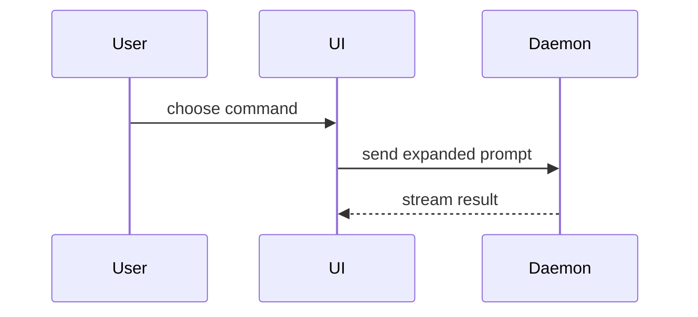

# Visual Menu for PR Summaries

Pick the **smallest view** that makes the key point of the diff clear.

## 1. Pseudocode — Logic or Algorithm

```text
on(save)
  if content is unchanged
    return cached result
  write new content
  return fresh result
```

## 2. Call Tree — Runtime Control Flow

```text
submitForm
  createSession
    persistPrompt
    launchAgent
  navigateToSession
```

## 3. Component Tree — UI Structure, State, and Module Boundaries

```text
<SessionPage> (apps/example/src/routes/session.tsx)
  useSessionEvents()
  <SessionToolbar>
    <RunActionButton> (packages/ui)
```

## 4. Shallow File Tree — File Responsibility or Broad Refactor

```text
src/
├── commands/       # parses user actions
├── sessions/       # owns session state
└── transport/      # sends API requests
```

## 5. Mermaid — Component Interaction, Control Flow, or Data Flow



*(Use standard Mermaid diagram types: `flowchart`, `sequenceDiagram`, `stateDiagram-v2`, `classDiagram`, `erDiagram`.)*

## 6. Scoped `diff` — When the Surrounding Shape Already Exists

Match the diff shape to the topic.

**Component change:**

```diff
 <SessionPage>
   useSessionEvents()
   <SessionToolbar>
+    <RunActionButton />
   <SessionTimeline>
+    <ActionResultCard />
```

**File-layout change:**

```diff
 src/
 ├── commands/
+│   └── show-me.ts       # expands the command
 ├── sessions/
-└── transport.ts
+└── transport/
+    ├── client.ts
+    └── stream.ts
```

**Call-tree or call-stack change:**

```diff
 submitForm
   createSession
     persistPrompt
+    expandMention
     launchAgent
-  navigateToSession
+  navigateToSession
+    subscribeToEvents
```

**State or control-flow change:**

```diff
 on(save)
-  write content
+  if content is unchanged
+    return cached result
+  write new content
+  invalidate cache
```

## 7. Whole Block — Mostly New Code or Copyable Target Shape

Show the whole block when most of it is new, when omitted context would hide ownership or order, or when the reviewer needs a copyable target shape:

```ts
function normalizeCommand(command: string): string {
  return command.trim().replace(/^\/+/, "");
}
```

---

## Placement & Restraint Guidance

- Place each visual immediately next to the short text it supports.
- Keep only the calls, files, props, states, and boundaries needed to make the change clear or resolve the current review question.
- Use one visual, or a small combination when a PR has genuinely distinct facets—never dump every visual type into one PR body.

---

*Attribution: This visual menu and placement guidance come from [Dex Horthy](https://github.com/dexhorthy)'s [`show-me`](https://github.com/humanlayer/humanlayer) skill (Humanlayer), as adapted for PR diffs in [Matt Pocock's `pr` skill](https://github.com/mattpocock/skills) (MIT License).*
